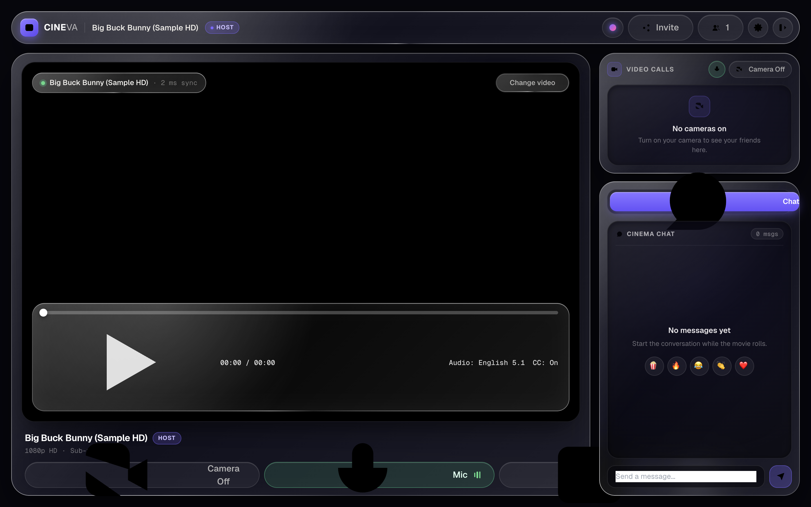
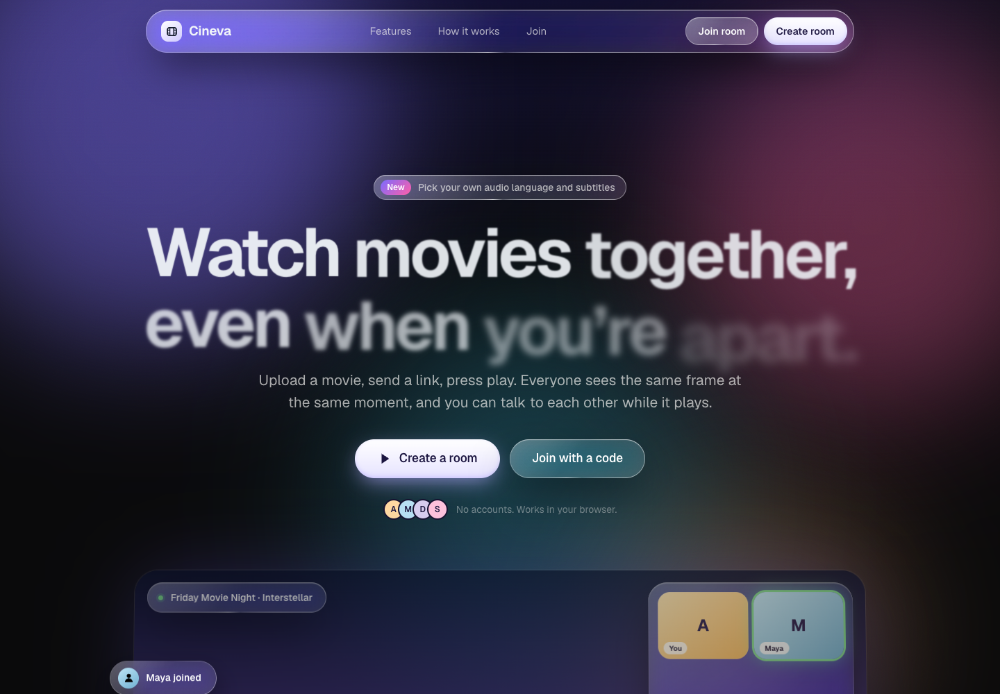

# CINEVA — Self-Hosted Watch-Party & Synchronized Video Playback

[](https://github.com/abbasahamed/cineva/actions/workflows/ci.yml)
[](LICENSE)
[](https://www.typescriptlang.org/)
[](https://nodejs.org/)

**CINEVA** is a self-hosted watch-party application for synchronized movie playback with remote guests. Built with TypeScript, React, Vite, Node.js, Express, Socket.IO, and Prisma, it synchronizes playback across play, pause, seek, and late-joining events.

Media is stored, processed, and served from the host's computer. Remote guests connect through a public tunnel; the tunnel provides network access, not media storage.

---

## 📸 Interface Preview

| Cinema Watch Room | Landing & Room Creation |
| :---: | :---: |
|  |  |

---

## 🌟 Key Features

- **Server-Authoritative Synchronization**: Authoritative server timeline eliminates client clock drift and desynchronization.
- **NTP-Style Clock Synchronization**: Continuous round-trip time (RTT) estimation and server clock offset calculations.
- **Gentle Drift Correction**:
  - **$\Delta < 0.25\text{s}$**: Normal playback without disruption.
  - **$0.25\text{s} \le \Delta < 1.0\text{s}$**: Sub-second playback rate tuning ($0.95\times$ / $1.05\times$) for smooth alignment without jarring jumps.
  - **$\Delta \ge 1.0\text{s}$**: Controlled seek to exact authoritative position.
- **Join-in-Progress Synchronization**: Late-joining guests calculate their position from the room timeline and current server time.
- **HTTP 206 Partial Content Range Streaming**: Native chunked byte-range video streaming for smooth seeking.
- **Local Disk Storage**: Movies are stored directly on the host machine's local disk (`uploads/`) with zero external cloud storage dependencies. Full HTTP 206 byte-range seeking and adaptive HLS streaming.
- **One-Command Remote Sharing**: Automated Cloudflare Quick Tunnel or Pinggy SSH tunnel with keep-awake guard (`npm run start:share`).
- **Instant Demo Room**: 1-click test environment pre-loaded with sample video.
- **Host Permission Controls**: Authoritative playback control by default with a toggle to allow guest playback control.
- **Real-Time Room Chat**: WebSocket room-scoped chat with HTML sanitization, rate limiting, and participant badges.
- **Participant Presence & Reconnection**: Session recovery across disconnects with grace period timeouts.
- **Responsive Cinema UI**: Sleek, distraction-free dark streaming interface with touch-friendly scrubbers, hover previews, and full keyboard shortcuts.

---

## 📁 Project Structure

```
/
├── apps/
│   ├── web/                    # React + Vite + Tailwind CSS Frontend
│   │   ├── src/
│   │   │   ├── components/     # VideoPlayer, Navbar, ChatPanel, ParticipantsList, Modals
│   │   │   ├── hooks/          # useSyncWatch (Drift correction loop, socket listener)
│   │   │   ├── pages/          # LandingPage, CreateRoomPage, JoinRoomPage, WatchRoomPage
│   │   │   ├── services/       # REST API client & Socket.IO client
│   │   │   └── __tests__/      # Frontend sync & drift calculation tests
│   │   └── vite.config.ts
│   │
│   └── server/                 # Node.js + Express + Socket.IO Backend
│       ├── prisma/             # Prisma schema & SQLite / Postgres migrations
│       ├── src/
│       │   ├── routes/         # REST API (/api/rooms, /api/media)
│       │   ├── services/       # syncEngine, roomManager, mediaStorage
│       │   ├── sockets/        # Real-time event handlers & clock sync
│       │   └── __tests__/      # Backend sync & room management unit tests
│       └── .env.example
│
└── packages/
    └── shared/                 # Shared TypeScript models, Zod schemas, socket events
        └── src/index.ts
```

---

## 🚀 Getting Started

### Prerequisites

- **Node.js**: v20 or higher
- **npm**: v9.0.0 or higher

### 1. Installation

Clone the repository and install all workspace dependencies:

```bash
git clone <repository_url> cineva
cd cineva
npm install
```

### 2. Environment Configuration

Copy the sample environment configuration:

```bash
cp .env.example apps/server/.env
```

Default `.env` settings:
```env
PORT=4000
NODE_ENV=development
CLIENT_URL=http://localhost:5173
DATABASE_URL="file:./dev.db"
MEDIA_STORAGE_PATH=./uploads
MAX_FILE_SIZE_MB=5120 # 5 GB per file
```

### 3. Database Migration

Generate the Prisma Client and initialize the database schema:

```bash
npm run db:push --workspace=@cineva/server
```

SQLite is configured by default for local development. To use PostgreSQL, set `DATABASE_URL` and select the PostgreSQL Prisma schema using the server's database setup script.

### 4. Build Shared Package

```bash
npm run build --workspace=@cineva/shared
```

---

## 💻 Development Commands

| Command | Description |
| :--- | :--- |
| `npm run dev` | Starts both backend (`localhost:4000`) and frontend (`localhost:5173`) concurrently |
| `npm run start:share` | Builds the app, starts the server, and establishes a secure public HTTPS tunnel with keep-awake guard |
| `npm run dev:server` | Starts Express & Socket.IO server with hot reloading via `tsx watch` |
| `npm run dev:web` | Starts Vite React frontend dev server |
| `npm run build` | Compiles all packages and bundles frontend assets |
| `npm run test` | Runs the full Vitest automated test suite across all workspaces |
| `npm run typecheck` | Typechecks all TypeScript files across the monorepo |
| `npm run lint` | Runs the workspace TypeScript checks |

---

## 🌐 Remote Sharing (Host a Watch Party)

CINEVA streams video from the host computer. A Cloudflare Quick Tunnel or Pinggy tunnel can provide remote access without router port forwarding; neither service stores movie files.

### One-Command Public Share

To host a screening for remote friends:

```bash
npm run start:share
```

This automated script performs the following:
1. **Checks Prerequisites**: Verifies `ffmpeg` and `ffprobe` are installed.
2. **Builds Monorepo**: Compiles `@cineva/shared`, `@cineva/server`, and `@cineva/web`.
3. **Spawns Server with Keep-Awake**: Starts the backend and automatically activates a system keep-awake lock (`caffeinate -dims` on macOS) so playback isn't interrupted by system sleep.
4. **Establishes Public HTTPS Tunnel**:
   - Primary: Uses **Cloudflare Quick Tunnels** (ephemeral `https://*.trycloudflare.com` URL with zero account setup needed).
   - Fallback: Automatically falls back to **Pinggy SSH Tunnels** if `cloudflared` binary is not found.
5. **Prints Ready Banner**: Outputs the shareable public screening URL directly in your terminal:
   ```
   ================================================================
     CINEVA — your private screening room is live
   ================================================================
     Public link:   https://your-room-id.trycloudflare.com
     Create a room: https://your-room-id.trycloudflare.com/create
   ```

Send this public link to your friends. When they visit it in any modern browser, they enter your room with real-time synchronized playback and chat.

---

## ⏱️ Synchronization Algorithm Details

### 1. Server Authoritative State

The server tracks a single authoritative state for each room:

$$\text{Position}_{\text{current}} = \text{StoredPosition} + \left(\frac{\text{ServerNow} - \text{LastUpdatedAt}}{1000}\right) \times \text{PlaybackRate}$$

When any host action occurs (`PLAY`, `PAUSE`, `SEEK`, `RATE`), the server increments the `version` counter and broadcasts the new state with the current server timestamp.

### 2. NTP Client-Server Clock Offset Estimation

To account for latency and clock drift between client devices and the server:
1. Client sends a timestamped `PING` ($t_0$).
2. Server responds with `PONG` containing the server's clock timestamp ($t_1$).
3. Client receives response ($t_2$) and estimates:
   $$\text{RTT} = t_2 - t_0$$
   $$\text{ServerOffset} = t_1 - \left(t_0 + \frac{\text{RTT}}{2}\right)$$
   $$\text{EstimatedServerNow} = \text{ClientNow} + \text{ServerOffset}$$

### 3. Client Drift Correction Loop

Every 500ms, each active client calculates:
$$\text{ExpectedPosition} = \text{PlaybackState.position} + \left(\frac{\text{EstimatedServerNow} - \text{PlaybackState.lastUpdatedAt}}{1000}\right) \times \text{PlaybackState.playbackRate}$$
$$\text{Drift} = \text{ExpectedPosition} - \text{video.currentTime}$$

- **$|\text{Drift}| < 0.25\text{s}$**: Video is in sync.
- **$0.25\text{s} \le |\text{Drift}| < 1.0\text{s}$**: Temporary gentle acceleration ($1.05\times$) or deceleration ($0.95\times$) smoothly brings the video into alignment without audio distortion or buffering.
- **$|\text{Drift}| \ge 1.0\text{s}$**: Direct controlled seek to `ExpectedPosition`.

---

## 📡 WebSocket Event Architecture & Audit

| Event Name | Direction | Sender | Receiver | Authoritative? | Description |
| :--- | :--- | :--- | :--- | :---: | :--- |
| `sync:ping` | Client $\to$ Server | Client | Server | N/A | NTP ping containing client timestamp |
| `sync:pong` | Server $\to$ Client | Server | Client | Yes | NTP pong with server timestamp for offset estimation |
| `room:join` | Client $\to$ Server | Client | Server | N/A | Authenticates session and enters room channel |
| `room:state` | Server $\to$ Client | Server | Client | Yes | Initial snapshot with calculated position & timestamp |
| `playback:play` | Client $\to$ Server | Host / Guest* | Server | Yes | Requests authoritative playback start |
| `playback:pause` | Client $\to$ Server | Host / Guest* | Server | Yes | Requests authoritative playback pause |
| `playback:seek` | Client $\to$ Server | Host / Guest* | Server | Yes | Requests authoritative timeline seek |
| `playback:rate` | Client $\to$ Server | Host / Guest* | Server | Yes | Requests authoritative playback speed adjustment |
| `playback:state` | Server $\to$ Room | Server | All Clients | Yes | Broadcasts authoritative state & incremented version |
| `room:updateSettings` | Client $\to$ Server | Host | Server | Yes | Toggles guest control or participant capacity |
| `room:updateTitle` | Client $\to$ Server | Host | Server | Yes | Updates display title for room media |
| `room:kickParticipant`| Client $\to$ Server | Host | Server | Yes | Removes a guest participant from room |
| `room:end` | Client $\to$ Server | Host | Server | Yes | Host ends room for all participants |
| `room:ended` | Server $\to$ Room | Server | All Clients | Yes | Signals all clients that room has terminated |
| `participant:joined` | Server $\to$ Room | Server | All Clients | Yes | Notifies presence of newly joined participant |
| `participant:left` | Server $\to$ Room | Server | All Clients | Yes | Notifies participant disconnect after grace timeout |
| `participant:kicked` | Server $\to$ Room | Server | All Clients | Yes | Notifies clients that a user was removed |
| `chat:send` | Client $\to$ Server | Client | Server | No | User submits a text chat message |
| `chat:message` | Server $\to$ Room | Server | All Clients | No | Broadcasts sanitized chat message to room |
| `chat:history` | Server $\to$ Client | Server | Client | No | Delivers recent chat log on join |

*\* Guest control is only permitted when the Host enables "Allow Guest Controls" in room settings.*

---

## 🔒 Security & Validation

- **No Binary Media in WebSockets**: Media files are transmitted via HTTP Range requests; WebSockets only carry state updates and chat.
- **Server Authority Verification**: `isHost` status is verified directly against the database session token on every action. Client-supplied flags are never trusted.
- **Upload Limits & MIME Inspection**: Maximum video upload size: 5 GB per file (5,368,709,120 bytes) with strict MIME and extension validation.
- **Path Traversal Protection**: Media file paths are strictly validated against the upload directory boundary.
- **Input Sanitization**: Chat messages and user display names are escaped to prevent XSS injection.
- **Input Validation**: Room, playback, and chat events use shared schemas; upload routes check file and room constraints.
- **Rate Limiting**: Express API rate limiter and WebSocket chat throttling prevent spam.
- **Collision-Resistant Room Codes**: Short 6-character uppercase codes (`A7K9PX`) using unambiguous character sets.

---

## 🧪 Testing

Execute automated unit and integration tests:

```bash
npm run test
```

### Tested Scenarios:
- Room creation and unique code validation
- Host vs guest permission boundaries
- Play/Pause state transitions and version increments
- Late-joining guest synchronization accuracy
- NTP clock offset calculation under simulated network latency
- Drift correction boundary conditions
- Reconnection session recovery
- HTTP range header responses

---

## 🚢 Deployment

CINEVA runs as a long-lived server on the host computer. The server serves the built web app, handles rooms and synchronization, and stores uploaded media locally. The host must stay online while guests are watching.

Build and start the server:

```bash
npm run build
npm start --workspace=@cineva/server
```

For remote guests without router port forwarding, use the tunnel launcher:

```bash
npm run start:share
```

It starts a Cloudflare Quick Tunnel when available and falls back to Pinggy. Both provide network access to the host; neither stores media. A custom reverse proxy can be used instead, with HTTPS and WebSocket forwarding enabled.

Keep the database and `MEDIA_STORAGE_PATH` on persistent storage and back them up together. The host's disk space and upload bandwidth limit the party. Configure `CLIENT_URL` and `ALLOWED_ORIGINS` for a custom public origin. When a tunnel is active, CINEVA accepts that tunnel's origin for browser requests.

See the [deployment guide](docs/DEPLOY.md), [architecture](docs/PRODUCTION_ARCHITECTURE.md), and [security notes](docs/SECURITY_AUDIT.md).

---

## 🛠️ Troubleshooting

| Issue | Cause | Solution |
| :--- | :--- | :--- |
| **`ffmpeg` or `ffprobe` not found** | FFmpeg is not installed or not in system `PATH`. | **macOS**: `brew install ffmpeg`<br>**Ubuntu/Debian**: `sudo apt install ffmpeg`<br>**Windows**: `winget install Gyan.FFmpeg` |
| **Port 4000 or 5173 collision** | Another process is occupying the default ports. | Change `PORT=4001` in `apps/server/.env` and update `CLIENT_URL` accordingly. |
| **Tunnel fails to establish** | Outbound tunnel ports are blocked or `cloudflared` is missing. | The runner falls back to Pinggy SSH tunnel. Verify outbound SSH (port 22 or 443) or install Cloudflare CLI: `brew install cloudflared`. |
| **Upload stops or fails for large files** | File exceeds maximum limit or disk is full. | By default, files up to 5 GB are supported. Increase `MAX_FILE_SIZE_MB` in `.env` if necessary and ensure sufficient disk space in `./uploads`. |
| **Video plays without audio in browser** | Container contains unsupported multi-channel audio codecs (e.g., raw AC3/EAC3 in non-Safari browsers). | CINEVA's FFmpeg pipeline automatically remuxes and transcodes audio to stereo AAC for universal browser playback. |

---

## ⚠️ System Limitations

- **Host Machine Dependency**: CINEVA runs on the host computer. If the host machine goes to sleep, loses power, or closes the terminal session, connected guests will be disconnected.
- **Host Upstream Bandwidth**: Because all video chunks are streamed directly from the host's local disk, the host's home internet upload speed determines streaming quality and capacity. For multiple remote 1080p streams, an upstream connection of at least 25–50 Mbps is recommended.
- **Hardware Acceleration**: FFmpeg transcoding leverages CPU encoding by default. Ensure adequate CPU headroom when hosting parties with high-bitrate media.

---

### ⚠️ Media & Copyright Compliance

> **CINEVA is designed for watching user-authorized media with friends. Users are responsible for having the necessary rights to upload and share media.**

- CINEVA provides real-time synchronization infrastructure. It does not package, distribute, or host copyrighted movies or television programming.
- The included sample trailer (`sample_video.mp4`) is provided strictly for demonstration and testing.
- Users and administrators must upload or stream only media they own or are legally authorized to view and share.

---

## 📚 Documentation Directory

- 🚀 [**Beginner Deployment Guide** (`docs/DEPLOY.md`)](docs/DEPLOY.md): Step-by-step launch guide for local and VPS hosting.
- 📋 [**Live Verification Checklist** (`docs/LIVE_TEST_CHECKLIST.md`)](docs/LIVE_TEST_CHECKLIST.md): Production smoke test and live measurement table.
- 🔄 [**Rollback & Incident Recovery** (`docs/ROLLBACK.md`)](docs/ROLLBACK.md): Procedures for rolling back frontend, backend, or database changes.
- 🛡️ [**Security & Hardening Audit** (`docs/SECURITY_AUDIT.md`)](docs/SECURITY_AUDIT.md): Comprehensive security model and threat mitigations.
- 🏗️ [**Production Architecture Specification** (`docs/PRODUCTION_ARCHITECTURE.md`)](docs/PRODUCTION_ARCHITECTURE.md): Control vs. data plane, NTP clock sync, and streaming topology.

---

## 🤝 Community & Contributing

We welcome contributions to CINEVA! Please review our community guides before submitting pull requests:
- 📖 [**Contributing Guidelines**](CONTRIBUTING.md)
- 🔒 [**Security Policy**](SECURITY.md)
- 📜 [**Code of Conduct**](CODE_OF_CONDUCT.md)

---

## 📄 License

Distributed under the [MIT License](LICENSE). Copyright © 2026 Abbas Ahamed.

