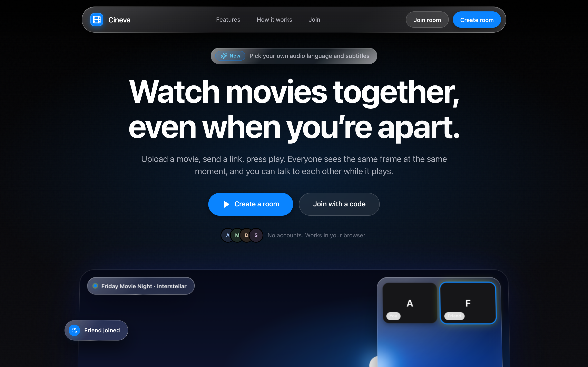
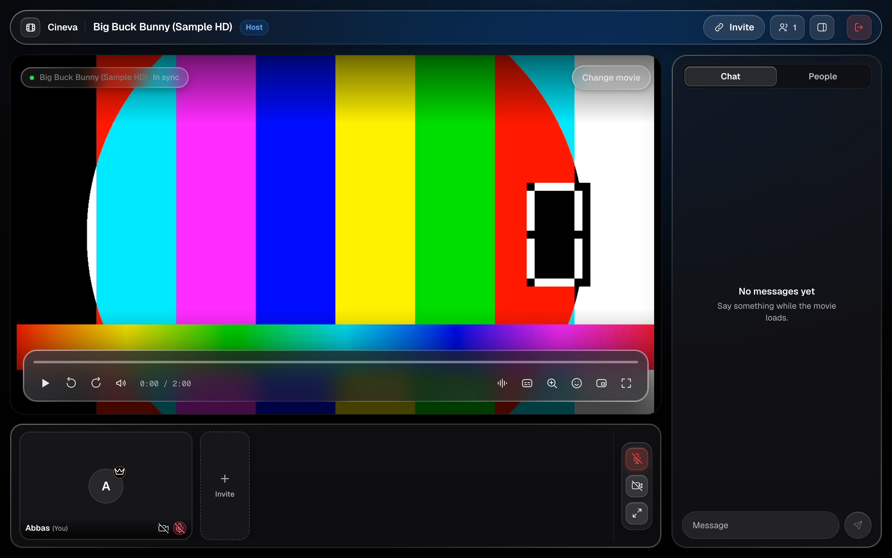
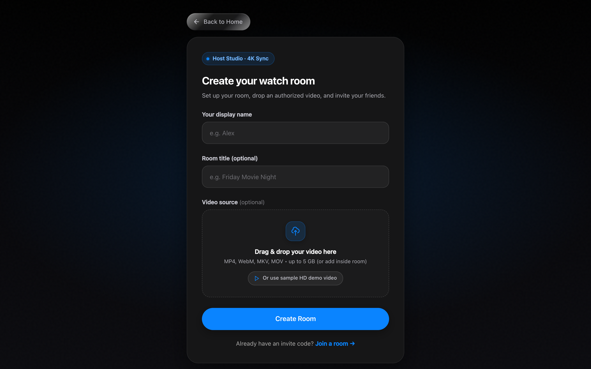
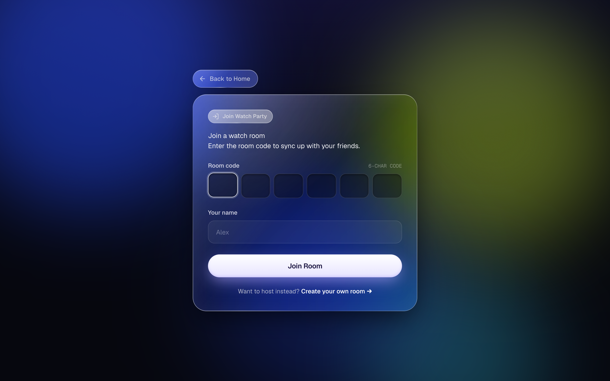

# CINEVA

[](LICENSE)
[](https://nodejs.org/)
[](https://www.typescriptlang.org/)
[](https://www.prisma.io/)

**CINEVA** is a self-hosted watch-party application designed for synchronized movie playback with remote friends. Built as a TypeScript monorepo with React, Vite, Node.js, Express, Socket.IO, and Prisma, CINEVA enables a host to stream movies directly from their personal computer to guests anywhere in the world.

The core architecture is strictly self-hosted: media files are stored, processed, and streamed directly from the host's local filesystem. Remote guests connect to the host through a local network address or an ephemeral public tunnel (Cloudflare Quick Tunnel or Pinggy SSH). The tunnel provides transport connectivity between host and guests; neither provider stores or hosts persistent media files, though transit packet buffering occurs during streaming.

---

## Interface Preview

| Landing Experience | Cinema Watch Room |
| :---: | :---: |
|  |  |
| *Modern landing page with room creation and direct code entry* | *Dark cinema player with synchronized timeline, chat, and participants* |

| Room Creation & Media Staging | Join Watch Party |
| :---: | :---: |
|  |  |
| *Host studio with local drag-and-drop video upload up to 5 GB* | *Invite code joining interface with instant session restoration* |

---

## Overview

Most commercial watch-party extensions require all participants to maintain identical third-party streaming subscriptions or rely on cloud object storage buckets (such as Amazon S3 or Backblaze B2).

CINEVA takes a different approach:
- **Host-Centric Streaming**: The host provides the video file from their computer (`./uploads`).
- **Server-Authoritative Clock**: The host's machine runs the backend server, maintaining the single authoritative timeline for the room.
- **Local Media Storage**: Movies remain on your local disk. Video chunks are served via standard HTTP 206 Partial Content byte-range requests.
- **Millisecond Clock Estimation & Synchronization**: Clients calculate server clock offsets via continuous NTP-style ping/pong exchanges, adjusting playback speed seamlessly when drift occurs.
- **Host Availability Requirement**: Because media is served directly from the host machine, the host's computer and server process must remain running, awake, and connected to the Internet throughout the screening session.

---

## Core Features

- **Server-Authoritative Synchronization**:
  - The server maintains the master playback state (current position, playback rate, paused state, and update timestamp).
  - Continuous NTP-style round-trip time (RTT) estimation and server clock offset calculations.
  - **Multi-Tier Drift Correction Controller**:
    - Evaluated on a 250ms periodic loop using estimated server time and measured RTT.
    - $|\Delta| < 120\text{ms}$: Synchronized; standard playback rate maintained.
    - $120\text{ms} \le |\Delta| < 400\text{ms}$: Gentle $\pm 8\%$ rate tuning ($0.92\times$ or $1.08\times$) gently restores alignment while leveraging browser pitch preservation.
    - $400\text{ms} \le |\Delta| < 1.2\text{s}$: Responsive $\pm 25\%$ catch-up tuning ($0.75\times$ or $1.25\times$).
    - $|\Delta| \ge 1.2\text{s}$: Direct seek to the target playhead position (with a 600ms cooldown to prevent seek thrashing).
- **Late-Join Synchronization**: Guests joining mid-movie immediately calculate the current playhead position from the server room clock and buffer the correct video frame without restarting.
- **Local Media Storage**:
  - Direct local file storage on host disk (`apps/server/uploads/`).
  - Supports video files up to 5 GB (`.mp4`, `.webm`, `.mkv`, `.mov`, `.ogg`).
  - Disk quota protection (default 20 GB ceiling) prevents storage exhaustion.
  - HTTP 206 Partial Content range requests for seeking.
- **FFmpeg & FFprobe Integration**:
  - Automatic codec inspection and container validation.
  - Remuxes and transcodes unsupported audio formats (e.g. multi-channel AC3/EAC3) to stereo AAC for broad browser playback compatibility.
  - Generates adaptive HLS playlists with subtitle and audio track extraction where supported.
- **Instant Demo Trailer**: Includes a 1-click test environment pre-loaded with an sample video for immediate testing without personal media files.
- **Real-Time Room Chat**: Low-latency WebSocket chat scoped to the active room, featuring input sanitization, rate limiting, and host badges.
- **WebRTC Voice & Video Calling**: Peer-to-peer mesh signaling (via public Google STUN servers) allows participants to see and talk to each other alongside movie playback, complete with microphone/camera toggles and a fullscreen participant gallery. (Mesh architecture is suited for small groups of 2–5 peers; restrictive symmetric NATs without a TURN server may limit connectivity).
- **Granular Room Permissions**:
  - Host controls playback by default.
  - Host can toggle "Allow Guest Controls" to permit remote play/pause/seek.
  - Host can kick participants or end the screening room at any time.
- **One-Command Remote Sharing**: Automated script (`npm run start:share`) builds packages, launches the server, acquires a macOS keep-awake lock (`caffeinate`), and establishes a public HTTPS tunnel with Cloudflare or Pinggy fallback.
- **System Diagnostics Endpoint**: Safe diagnostics route (`/api/system/diagnostics`) reports FFmpeg availability, disk headroom, and transcoding self-test results without exposing credentials.

---

## Architecture and Technology Stack

CINEVA is organized as an npm workspaces monorepo:

```
cineva/
├── apps/
│   ├── web/                    # React 19 + Vite 6 + Tailwind CSS Frontend SPA
│   │   ├── src/
│   │   │   ├── components/     # VideoPlayer, Navbar, ChatPanel, FileRow, Dropzone
│   │   │   ├── features/video/ # WebRTC VideoCallManager, ParticipantGalleryModal
│   │   │   ├── hooks/          # useSyncWatch (NTP drift correction loop, socket events)
│   │   │   ├── pages/          # LandingPage, CreateRoomPage, JoinRoomPage, WatchRoomPage
│   │   │   └── services/       # REST API client and Socket.IO connection manager
│   │   └── vite.config.ts
│   │
│   └── server/                 # Node.js + Express + Socket.IO Backend
│       ├── prisma/             # Prisma schema & SQLite / PostgreSQL migrations
│       ├── src/
│       │   ├── routes/         # REST API (/api/rooms, /api/media, /api/system)
│       │   ├── services/       # roomManager, mediaStorage, hlsPackager, binaryResolver
│       │   ├── sockets/        # Real-time WebSocket event handlers & NTP sync
│       │   └── utils/          # Client IP detection, disk quota checks, logger
│       └── .env.example
│
├── packages/
│   └── shared/                 # Shared TypeScript models, Zod validation schemas, socket contracts
│       └── src/index.ts
│
├── scripts/                    # Development runners, tunnel launcher, acceptance tests
│   ├── start-share.mjs         # One-command tunnel and keep-awake host runner
│   ├── runAcceptanceTests.js   # Automated integration test suite
│   └── verify-all-steps.mjs    # Multi-step verification suite
│
└── docs/                       # Architecture, deployment, security, and rollback documentation
    ├── DEPLOY.md               # Production deployment guide
    ├── PRODUCTION_ARCHITECTURE.md # Architecture specification and data plane
    ├── SECURITY_AUDIT.md       # Security boundary audit and mitigations
    ├── ROLLBACK.md             # Incident recovery and rollback procedures
    └── screenshots/            # Verified interface screenshots
```

### Key Technologies

- **Frontend**: React 19, TypeScript, Vite 6, Tailwind CSS 3, Lucide React, Socket.IO Client.
- **Backend**: Node.js 20+, Express 4, Socket.IO 4, Prisma ORM 6, Multer, Fluent-FFmpeg, Express Rate Limit.
- **Database**: SQLite (default local development database at `apps/server/prisma/dev.db`) or PostgreSQL.
- **Media Engine**: Local FFmpeg & FFprobe binaries with HTTP 206 Partial Content byte-range streaming.
- **Networking**: Cloudflare Quick Tunnels (`trycloudflare.com`) or Pinggy SSH (`free.pinggy.io`) for remote HTTPS access.

---

## Requirements

Before running CINEVA, ensure your system has the following tools installed:

1. **Node.js**: `v20.0.0` or higher (`node -v`).
2. **npm**: `v9.0.0` or higher (`npm -v`).
3. **FFmpeg & FFprobe**: Required for media analysis, codec transcoding, and streaming.
   - **macOS**: `brew install ffmpeg`
   - **Ubuntu / Debian**: `sudo apt update && sudo apt install -y ffmpeg`
   - **Windows**: `winget install Gyan.FFmpeg` or download from [ffmpeg.org](https://ffmpeg.org/download.html).
4. **Database**: SQLite is enabled by default with zero configuration. For production VPS deployments, PostgreSQL is optionally supported.
5. **Operating System**: macOS, Linux, or Windows (WSL recommended for Windows environments). macOS includes automatic `caffeinate` support to prevent sleep during active screenings.

---

## Installation and Local Development

Follow these steps to set up CINEVA locally from scratch:

### 1. Clone the Repository

```bash
git clone https://github.com/abbasahamed/cineva.git
cd cineva
npm ci
```

> **Note**: The GitHub repository's default branch is `feature/ui-polish` (the active release branch). If you are switching branches or updating an existing clone, ensure you are on `git switch feature/ui-polish`.

### 2. Configure Environment Variables

Copy the example environment configuration into the server workspace:

```bash
cp .env.example .env
cp .env.example apps/server/.env
```

Default configuration in `.env`:
```env
PORT=4000
NODE_ENV=development
CLIENT_URL=http://localhost:5173
ALLOWED_ORIGINS=http://localhost:5173,https://cineva.app
DATABASE_URL="file:./dev.db"
MEDIA_STORAGE_PATH=./uploads
MAX_FILE_SIZE_MB=5120
MAX_TOTAL_STORAGE_GB=20
ENABLE_TUNNEL=true
KEEP_AWAKE=true
```

### 3. Initialize the Database and Build Packages

Build the shared package and initialize the SQLite database schema:

```bash
npm run build --workspace=@cineva/shared
npm run db:push --workspace=@cineva/server
```

*(Note: `npm run db:push` automatically generates the Prisma Client and applies schema migrations to `dev.db`.)*

### 4. Start the Application

You can start both the backend and frontend concurrently with a single command:

```bash
npm run dev
```

- **Frontend**: Accessible at `http://localhost:5173`
- **Backend API**: Accessible at `http://localhost:4000`
- **Health Check**: `http://localhost:4000/api/health`

Alternatively, you can run the backend and frontend in separate terminals:

```bash
# Terminal 1 — Backend Server
npm run dev:server

# Terminal 2 — Frontend Client
npm run dev:web
```

---

## How to Use CINEVA

### Hosting a Watch Party

1. **Start the Service**: Run `npm run dev` for local network watch parties, or `npm run start:share` to host for remote friends across the Internet.
2. **Open the Application**: Navigate to `http://localhost:5173` (or your public tunnel URL) in your browser.
3. **Create a Watch Room**: Click **Create room**, enter your display name (e.g., "Abbas"), and optionally enter a room title.
4. **Select Media**:
   - Drag and drop your video file (MP4, WebM, MKV, MOV up to 5 GB).
   - Alternatively, click **Or use sample HD demo video** to test immediately with the included sample trailer.
5. **Prepare Media**: Click **Create Room**. The backend validates the video format and stages it for streaming.
6. **Invite Friends**: Copy the generated invite link or click the WhatsApp share button.
7. **Enter Theater**: Click **Enter Theater** to enter the cinema room. Use the playbar to play, pause, or seek. All connected guests will follow your actions automatically.

### Joining as a Guest

1. **Open the Link**: Open the shared invitation link in your browser, or visit `http://localhost:5173/join` (or the host's tunnel URL).
2. **Enter Room Code**: If not pre-filled, type the 6-character room code (e.g., `WPDNZ4`).
3. **Set Display Name**: Enter your name and click **Join Room**.
4. **Permissions**: Allow camera and microphone permissions if you wish to participate in video or voice chat.
5. **Watch Together**: Playback will automatically synchronize to the host's playhead position. Use the right sidebar to chat with other participants.

---

## Media, Networking, and Privacy

### Local Media Storage
All uploaded videos reside on the host's machine in `apps/server/uploads/`. CINEVA does not upload your movies to AWS, Backblaze, Cloudflare, or any external object storage service. When a room expires or is ended by the host, staged media files are automatically cleaned up.

### Upload Limits and Disk Safeguards
- **Per-file limit**: 5 GB (`MAX_FILE_SIZE_MB=5120`).
- **Total quota**: 20 GB (`MAX_TOTAL_STORAGE_GB=20`). The server checks available disk space before accepting uploads to prevent filling the host's storage.

### Host Bandwidth and Network Requirements
Because video bytes stream directly from the host machine to every guest, the host's home internet upload speed dictates playback quality and the number of simultaneous viewers. Self-hosting shifts availability, bandwidth, storage, and security responsibilities to the host. For streaming 1080p video to 3–5 remote guests, an upload bandwidth of at least 25–50 Mbps is recommended.

### Public Tunnels and Connectivity
When running `npm run start:share`, CINEVA establishes a public tunnel:
- **Primary**: Cloudflare Quick Tunnels (`https://*.trycloudflare.com`).
- **Fallback**: Pinggy SSH Tunnels (`https://*.free.pinggy.net`).

Tunnels forward encrypted HTTPS/WSS traffic directly to your local port 4000. Tunnel intermediaries provide transport connectivity and transit packet buffering; no persistent video files or user databases are stored on intermediary servers. Note that free tunnel sessions are ephemeral (free Pinggy tunnels expire after 60 minutes).

### System Sleep & Keep-Awake
If the host's laptop goes to sleep or loses Wi-Fi connection, the server will stop responding and remote guests will disconnect. On macOS, CINEVA automatically activates a `caffeinate -dims` process during active screening sessions to prevent system sleep.

---

## Configuration Reference

### Backend Server (`apps/server/.env`)

| Variable | Purpose | Required | Default / Safe Example |
| :--- | :--- | :---: | :--- |
| `PORT` | Local port for Express and Socket.IO | No | `4000` |
| `NODE_ENV` | Runtime environment mode | No | `development` (use `production` on servers) |
| `CLIENT_URL` | Primary frontend URL allowed for CORS | No | `http://localhost:5173` |
| `ALLOWED_ORIGINS` | Comma-separated list of allowed CORS origins | No | `http://localhost:5173,https://cineva.app` |
| `DATABASE_URL` | Prisma database connection string | Yes | `"file:./dev.db"` (or PostgreSQL URL) |
| `MEDIA_STORAGE_PATH` | Local disk directory for video staging | No | `./uploads` |
| `MAX_FILE_SIZE_MB` | Maximum video file upload size in MB | No | `5120` (5 GB) |
| `MAX_TOTAL_STORAGE_GB`| Maximum total disk space allocated for uploads | No | `20` (20 GB) |
| `ENABLE_TUNNEL` | Automatically spawn public tunnel on startup | No | `true` |
| `KEEP_AWAKE` | Prevent macOS system sleep during playback | No | `true` |

### Frontend Client (`apps/web/.env`)

| Variable | Purpose | Required | Safe Example |
| :--- | :--- | :---: | :--- |
| `VITE_API_URL` | Base URL of the backend REST API | No | `http://localhost:4000` (omit to use current origin) |
| `VITE_SOCKET_URL` | Base URL for Socket.IO connection | No | `http://localhost:4000` (omit to use current origin) |

> **Security Note**: All `VITE_*` variables are bundled into client-side JavaScript and visible to anyone inspecting network requests. Never place private keys, database passwords, or server credentials in `VITE_*` variables.

---

## Testing and Quality Verification

Verify code quality and test coverage across the monorepo with the following commands:

```bash
# Type check all TypeScript workspaces
npm run typecheck

# Run automated Vitest test suite across workspaces (12 test suites, 122 tests)
npm run test

# Compile all workspaces and bundle frontend production distribution
npm run build
```

---

## Deployment Architecture

CINEVA separates the user interface from the stateful media backend:

```
┌─────────────────────────────────┐           ┌──────────────────────────────────┐
│         Static Frontend         │           │        Self-Hosted Host          │
│   (Vercel or Local Vite SPA)    │           │      (Personal Mac / VPS)        │
│                                 │           │                                  │
│  • React 19 UI                  │  HTTPS    │  • Node.js + Express API         │
│  • WebRTC Media Controls        │──────────>│  • Socket.IO NTP Sync Engine     │
│  • Local Drift Correction Loop  │  WSS      │  • Local Disk Storage (./uploads)│
│                                 │           │  • FFmpeg Transcoding Pipeline   │
└─────────────────────────────────┘           └──────────────────────────────────┘
```

1. **Frontend Hosting (Vercel)**:
   - The React single-page app can be deployed to Vercel (e.g. `cineva-web-one.vercel.app`).
   - The deployed frontend requires `VITE_API_URL` and `VITE_SOCKET_URL` pointing to an active, reachable backend.
   - The static frontend cannot store movie files or run FFmpeg transcoding.
2. **Backend Hosting (Self-Hosted / VPS)**:
   - Run directly on the host machine using `npm run start:share`.
   - Or deploy to a persistent Node.js VPS (such as Hetzner, DigitalOcean, or Render with persistent disk storage) equipped with FFmpeg.
   - For detailed setup instructions, consult the [Production Deployment Guide](docs/DEPLOY.md).

---

## Documentation Index

- [Production Deployment Guide (`docs/DEPLOY.md`)](docs/DEPLOY.md): Guide for self-hosting on local machines or Linux VPS.
- [Production Architecture (`docs/PRODUCTION_ARCHITECTURE.md`)](docs/PRODUCTION_ARCHITECTURE.md): Technical deep-dive into the control plane, data plane, and NTP sync model.
- [Security Audit & Hardening (`docs/SECURITY_AUDIT.md`)](docs/SECURITY_AUDIT.md): Threat modeling, input sanitization, and upload safety controls.
- [Deployment Checklist (`docs/DEPLOYMENT_CHECKLIST.md`)](docs/DEPLOYMENT_CHECKLIST.md): Step-by-step checklist for release verification.
- [Rollback & Incident Recovery (`docs/ROLLBACK.md`)](docs/ROLLBACK.md): Disaster recovery and rollback runbooks.

---

## Contributing

We welcome contributions to CINEVA! To contribute:

1. **Fork** the repository on GitHub.
2. **Create a Branch** for your work: `git checkout -b feature/my-feature`.
3. **Install Dependencies**: `npm ci`.
4. **Implement Changes**: Follow existing coding patterns, error handling, and TypeScript types.
5. **Validate**: Ensure `npm run typecheck`, `npm run test`, and `npm run build` pass with zero errors.
6. **Submit a Pull Request**: Describe your changes, motivation, and test coverage.

Please review our community documents before opening a pull request:
- [Contributing Guidelines](CONTRIBUTING.md)
- [Code of Conduct](CODE_OF_CONDUCT.md)
- [Security Policy](SECURITY.md)

---

## Security

If you discover a security vulnerability within CINEVA, please review our [Security Policy](SECURITY.md) for reporting procedures. Do not disclose vulnerabilities in public issue trackers.

---

## License

Distributed under the MIT License. See [LICENSE](LICENSE) for full details.

```
Copyright (c) 2026 Abbas Ahamed
```

---

## Acknowledgements

CINEVA is built upon open-source software:
- [React](https://react.dev/) & [Vite](https://vitejs.dev/)
- [Socket.IO](https://socket.io/)
- [Express](https://expressjs.com/)
- [Prisma ORM](https://www.prisma.io/)
- [FFmpeg](https://ffmpeg.org/) via [fluent-ffmpeg](https://github.com/fluent-ffmpeg/node-fluent-ffmpeg)
- [Tailwind CSS](https://tailwindcss.com/)
- [Lucide Icons](https://lucide.dev/)
- [Vitest](https://vitest.dev/)
